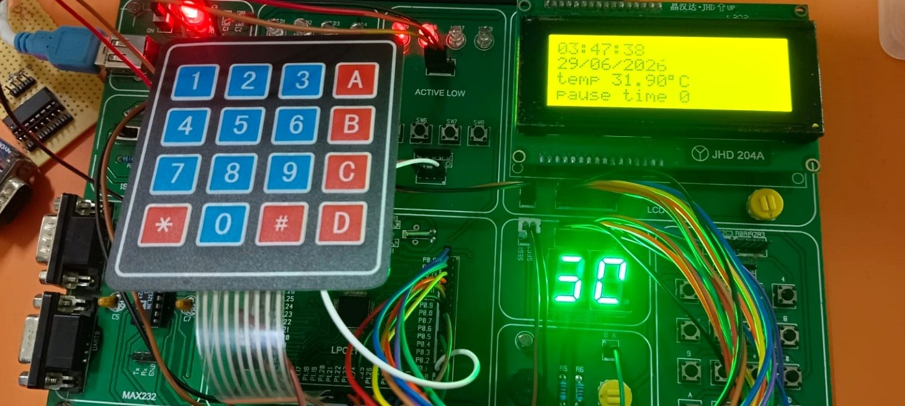
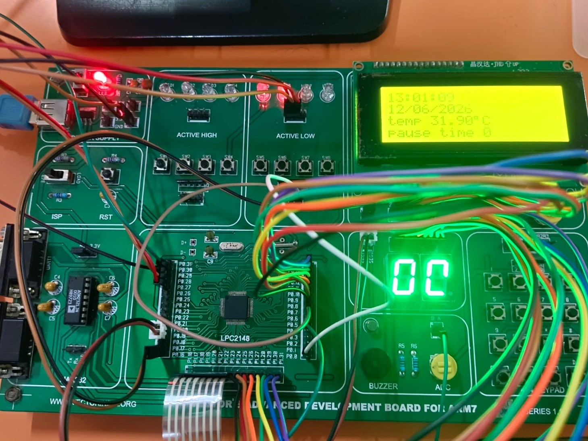
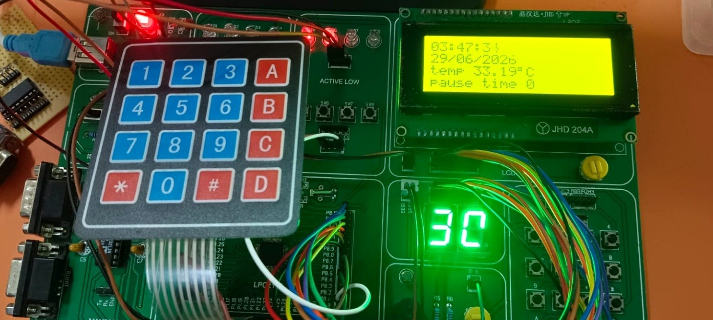

# Smart Exam Hall Monitoring and Management System

## 📌 Project Overview

The **Smart Exam Hall Monitoring and Management System** is an embedded system designed to assist in managing and monitoring examination sessions.

The system uses an **ARM7-based LPC2148 microcontroller** and integrates multiple peripherals, including an LCD, 4×4 keypad, RTC, ADC, LM35 temperature sensor, multiplexed 7-segment display, LEDs, buzzer, and external interrupts.

The system allows the user to configure examination parameters, monitor examination time, pause and resume the examination, monitor temperature, and provide visual and audio alerts.

## 🎯 Objectives

* Provide controlled examination session management.
* Allow authorized users to configure examination settings.
* Display real-time clock and date information.
* Set examination start time and duration.
* Display the remaining examination time.
* Monitor temperature using an LM35 sensor.
* Provide pause/resume functionality using an external interrupt.
* Provide LED warnings as examination time decreases.
* Activate a buzzer when the examination time expires.
* Protect configuration settings using a password.

## ⚙️ Hardware Requirements

* LPC2148 ARM7 microcontroller
* 16×2 LCD
* 4×4 matrix keypad
* Real-Time Clock (RTC)
* LM35 temperature sensor
* Analog-to-Digital Converter (ADC)
* Two-digit multiplexed 7-segment display
* LEDs
* Buzzer
* External interrupt switches
* Connecting wires and breadboard or project hardware setup
* Suitable power supply

## 💻 Software Requirements

* Embedded C
* ARM7 / LPC2148
* Keil µVision IDE
* ARM7 compiler/toolchain
* GPIO programming
* ADC programming
* RTC programming
* External interrupt programming
* LCD interfacing
* Keypad interfacing
* 7-segment display interfacing
* Register-level programming
* VIC interrupt controller

## 🧩 System Architecture

The LPC2148 acts as the main controller and interfaces with the LCD, keypad, RTC, ADC, LM35 temperature sensor, external interrupt, multiplexed 7-segment display, LEDs, and buzzer.

```text
                 +------------------+
                 |      LPC2148     |
                 |       ARM7       |
                 +---------+--------+
                           |
          +--------+-------+-------+--------+
          |        |       |       |        |
          v        v       v       v        v
         LCD     Keypad   RTC     ADC      EINT
                                   |      Pause /
                                  LM35    Resume
                                   |
                                   v
                              Temperature
                              Monitoring

                 +------------------+
                 |  Exam Management |
                 +---------+--------+
                           |
                +----------+----------+
                |          |          |
                v          v          v
             7-Segment    LEDs      Buzzer
             Remaining   Warnings   Exam End
               Time
```

## 📸 Project Demonstration

### 🔢 Keypad and LCD Display

The 4×4 matrix keypad is used for user input and configuration, while the LCD displays system information, examination status, temperature, and other parameters.



### 🔧 Project Hardware

The complete hardware setup of the Smart Exam Hall Monitoring and Management System.



### 🌡️ Temperature Display

The LM35 temperature sensor is interfaced with the LPC2148 ADC, and the measured temperature is displayed on the LCD.



## 📁 Project Structure

```text
Smart-Exam-Hall-Monitoring-System/
├── Smart_Exam_Hall_Monitoring_and_Management_System1.c
├── project.c
├── project.h
├── project_declaration.h
├── project_definations.c
├── declaration.h
├── all_macro1.h
├── system_architecture.png
├── images/
│   ├── keypad_and_display.jpg
│   ├── project_hardware.jpg
│   └── temperature_display.jpg
└── README.md
```

## 📄 File Description

| File / Folder                                         | Purpose                                                                 |
| ----------------------------------------------------- | ----------------------------------------------------------------------- |
| `Smart_Exam_Hall_Monitoring_and_Management_System1.c` | Main application logic and interrupt handling                           |
| `project.c`                                           | LCD, keypad, ADC, LM35, delay, and 7-segment driver implementations     |
| `project.h`                                           | Function declarations for peripheral modules                            |
| `project_declaration.h`                               | Function declarations for exam-management and RTC functions             |
| `project_definations.c`                               | Password, RTC, exam configuration, and exam-management functions        |
| `declaration.h`                                       | Peripheral function declarations                                        |
| `all_macro1.h`                                        | Microcontroller definitions, data types, macros, and pin configurations |
| `system_architecture.png`                             | System architecture diagram                                             |
| `images/`                                             | Project hardware and demonstration images                               |
| `README.md`                                           | Project documentation                                                   |

## 🔩 Major Modules

* **LPC2148 ARM7:** Main controller.
* **16×2 LCD:** Displays time, date, temperature, and examination information.
* **4×4 Matrix Keypad:** User input and configuration.
* **RTC:** Real-time clock and date management.
* **LM35 + ADC:** Temperature monitoring.
* **External Interrupts:** Configuration and pause/resume control.
* **Two-Digit 7-Segment Display:** Displays remaining examination time.
* **LED Warning System:** Provides time-based visual warnings.
* **Buzzer:** Provides an examination completion alert.
* **Exam Management Logic:** Handles start time, duration, pause/resume, and remaining-time calculation.

## 🔐 Password-Protected Configuration

The system uses a password to protect examination configuration settings.

When the configuration interrupt is triggered:

1. The user is asked to enter the password.
2. The entered password is compared with the stored password.
3. The user gets limited password attempts.
4. After successful authentication, the user can access the configuration menu.

The configuration menu provides options for:

* RTC time
* RTC date
* Examination start time
* Examination duration
* Password modification

## ⏰ Examination Time Management

The administrator can configure:

* Examination start hour
* Examination start minute
* Examination duration

The system continuously compares the configured examination start time with the RTC.

Once the configured start time is reached, the examination session begins automatically.

## ⏱️ Remaining Time Display

The remaining examination time is displayed using a two-digit multiplexed 7-segment display.

The system calculates the remaining examination time as:

**Remaining Time = Exam Duration − Effective Elapsed Time**

The system also accounts for the paused duration so that the examination countdown does not decrease while the examination is paused.

## ⏸️ Pause / Resume Function

An external interrupt is used to pause and resume the examination.

When the pause interrupt occurs:

1. The current examination time is recorded.
2. The examination countdown is paused.
3. The pause count is incremented.

When the interrupt occurs again:

1. The examination resumes.
2. The paused duration is excluded from the examination countdown.
3. The LCD displays the pause count and current pause status.

## 🌡️ Temperature Monitoring

An LM35 temperature sensor is connected to the LPC2148 ADC.

The temperature measurement process is:

```text
LM35 Temperature Sensor
          |
          v
     Analog Voltage
          |
          v
      LPC2148 ADC
          |
          v
     ADC Conversion
          |
          v
  Temperature Calculation
          |
          v
       LCD Display
```

The temperature is calculated and displayed in degrees Celsius.

## 🚦 LED Warning System

The system provides visual warnings based on the remaining examination time.

| Remaining Time       | Indicator |
| -------------------- | --------- |
| More than 15 minutes | Normal    |
| 15 minutes or less   | LED3      |
| 10 minutes or less   | LED2      |
| 5 minutes or less    | LED1      |
| 0 minutes            | Buzzer    |

The LED warning level changes automatically as the examination approaches completion.

## 🔔 Examination Completion

When the remaining examination time reaches zero, the examination ends and the buzzer provides an audio indication.

```text
Remaining Time = 0
        |
        v
    Exam Ends
        |
        v
      Buzzer
```

## 🔄 Overall Working Flow

```text
Power ON
   |
   v
Initialize LPC2148 Peripherals
   |
   v
Initialize LCD, Keypad, ADC,
7-Segment Display and RTC
   |
   v
Display Smart Exam Monitor System
   |
   v
Wait for Configuration Interrupt
   |
   v
Password Authentication
   |
   v
Configure RTC / Exam Time /
Duration / Password
   |
   v
Wait for Configured Exam Start Time
   |
   v
Start Examination
   |
   v
Display Remaining Time
   |
   v
Monitor Temperature
   |
   v
Monitor Pause / Resume Interrupt
   |
   v
Generate LED Warnings
   |
   v
Remaining Time = 0
   |
   v
Activate Buzzer
   |
   v
Exam Completed
```

## 🛠️ Build and Execution

### 1. Open the Project

Open the project source files in Keil µVision with the appropriate ARM7/LPC2148 project configuration.

### 2. Configure the Target

Select the target device and configure the project for the LPC2148 ARM7 microcontroller.

### 3. Add Source Files

Make sure all required source and header files are included in the Keil project.

### 4. Compile the Project

Build the project using the Keil build option and check for compilation errors and warnings.

### 5. Generate the HEX File

Configure the project to generate the required `.hex` file after a successful build.

### 6. Program the Microcontroller

Use a compatible LPC2148 programming/flashing tool to transfer the generated HEX file to the microcontroller.

### 7. Connect the Hardware

Connect the LCD, keypad, RTC, LM35, 7-segment display, LEDs, buzzer, and external interrupt switches according to the project hardware configuration.

### 8. Run the System

Power on the system and verify initialization, configuration, examination timing, temperature monitoring, pause/resume operation, LED warnings, and examination completion.

## 🧪 Testing and Verification

Each major module was tested individually before integrating it into the complete system.

| Module             | Test Performed      | Expected Result                                    |
| ------------------ | ------------------- | -------------------------------------------------- |
| LCD                | Display test        | Text and values displayed correctly                |
| Keypad             | Key press test      | Correct key input detected                         |
| RTC                | Time/date test      | Correct time and date displayed                    |
| ADC + LM35         | Temperature test    | Temperature measured and displayed                 |
| 7-Segment          | Countdown test      | Remaining time displayed correctly                 |
| External Interrupt | Pause/resume test   | Examination pauses and resumes correctly           |
| LEDs               | Warning test        | Correct LED activated according to remaining time  |
| Buzzer             | Completion test     | Buzzer activates when examination ends             |
| Password           | Authentication test | Configuration accessible only after valid password |

### Integrated Testing

After individual module verification, the modules were integrated and tested as a complete system.

The following complete flow was verified:

```text
Power ON
   |
   v
Peripheral Initialization
   |
   v
Password Authentication
   |
   v
Exam Configuration
   |
   v
Exam Start
   |
   v
Countdown
   |
   v
Temperature Monitoring
   |
   v
Pause / Resume
   |
   v
LED Warnings
   |
   v
Exam Completion
   |
   v
Buzzer Alert
```

## 📸 Output and Demonstration

The repository contains project demonstration images showing the hardware and system output.

### Keypad and LCD Output


### Complete Hardware Setup


### Temperature Monitoring Output


These images provide visual evidence of the implemented hardware and system operation.

## ⚠️ Challenges Faced and Solutions

### 1. Multiplexed 7-Segment Display

**Challenge:** Displaying the remaining examination time using a two-digit multiplexed 7-segment display requires continuous refreshing of both digits.

**Solution:** Implemented multiplexing logic with appropriate timing and digit selection to provide a stable display.

### 2. Pause / Resume Timing

**Challenge:** The examination countdown should not decrease while the examination is paused.

**Solution:** The pause time is recorded and excluded from the effective elapsed examination time.

### 3. Temperature Measurement

**Challenge:** The LM35 provides an analog voltage that must be converted into a meaningful temperature value.

**Solution:** The ADC is used to convert the analog signal into a digital value, which is then processed to calculate the temperature.

### 4. External Interrupt Handling

**Challenge:** Configuration and pause/resume operations must respond to external events without affecting normal system operation.

**Solution:** External interrupts and the VIC interrupt controller are used to handle event-driven operations.

### 5. Multiple Peripheral Integration

**Challenge:** Several peripherals must operate together while maintaining correct timing and system behavior.

**Solution:** Each module was developed and tested individually before integrating the modules into the final application.

## 📚 Embedded Concepts Demonstrated

This project demonstrates practical implementation of:

* ARM7 microcontroller programming
* Embedded C
* GPIO programming
* Register-level programming
* LCD interfacing
* Matrix keypad interfacing
* ADC interfacing
* LM35 temperature sensing
* RTC programming
* External interrupts
* VIC interrupt configuration
* Multiplexed 7-segment display
* Bit manipulation
* Embedded timing and delays
* Password-based access control
* Real-time event handling
* Modular peripheral integration

## 🚀 Future Improvements

Possible future improvements include:

* Multiple examination hall support
* Centralized monitoring through CAN or UART
* Data logging
* EEPROM-based password and configuration storage
* Automatic attendance integration
* PC/mobile monitoring interface
* Real-time examination reports

## 👨‍💻 Author

**Shaik Jafar**

Electronics and Communication Engineering — Embedded Systems

## 📌 Project Type

**Embedded Systems Project — ARM7 / LPC2148**

The project was developed as a practical embedded-system application integrating multiple hardware peripherals and real-time event management.
